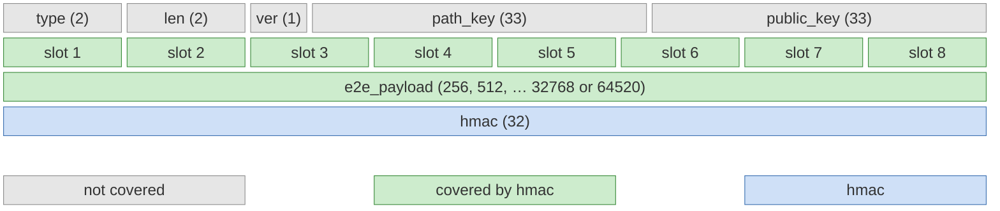

# Extension BOLT XX: Onion Messages Version 2

Authors:
  * Christian <TODO: email>

Created: 2026-09-23

# Table of Contents

- [Introduction](#introduction)
  * [Abstract](#abstract)
  * [Motivation](#motivation)
- [Conventions](#conventions)
- [Specification](#specification)
  * [Feature Bits](#feature-bits)
  * [Key Generation](#key-generation)
  * [Packet Structure](#packet-structure)
  * [The `onion_message_v2` Message](#the-onion_message_v2-message)
  * [Blinded Paths](#blinded-paths)
  * [The `e2e_payload`](#the-e2e_payload)
  * [Packet Construction](#packet-construction)
  * [Packet Processing](#packet-processing)
- [Rationale](#rationale)
- [Test Vectors](#test-vectors)

# Introduction

## Abstract

This document specifies version 2 of onion messages. Unlike version 1
(see [BOLT #4](04-onion-routing.md#onion-messages)), where every hop receives a
variable length `onionmsg_tlv`, version 2 separates the packet into:

 - a fixed size _routing header_ of 8 slots, each carrying only the encrypted
   identity of the next hop and an HMAC, and
 - an _end-to-end payload_ (`e2e_payload`) whose size is a power of 2, which is
   onion-encrypted with one layer per hop, using a key derived from each hop's
   shared secret.

Every hop's HMAC commits to both the routing header and the `e2e_payload` as seen
by that hop, so any modification is detected by the next honest hop.

Route blinding is retained: every hop, including the ones chosen by the origin
node, is addressed via a blinded node id, and the next `path_key` is carried
explicitly in each routing slot.

## Motivation

Onion messages are free to send, so the cost of relaying them has to be kept
as low and as predictable as possible. Version 1 allows the origin node to
place arbitrary TLV data for every hop, and does not bound the number of hops
other than via the total packet size. A malicious origin node can route a
single message through a cycle of nodes many times, multiplying the bandwidth
and CPU it consumes on the network.

Version 2 therefore:

 - bounds the number of forwards per message to 8,
 - reduces per-hop processing to fixed size, fixed position fields with no TLV
   parsing for forwarding nodes,
 - forbids sending a message back to the peer it was received from, so any
   cycle has a length of at least 3, and
 - moves all application data into a single `e2e_payload` only the final node
   can read.

# Conventions

The conventions of [BOLT #4](04-onion-routing.md#conventions) apply. In
addition:

 - `SLOT_LEN` = 114: the length of a single routing slot.
 - `NUM_SLOTS` = 8: the number of slots in the routing header.
 - `HEADER_LEN` = `NUM_SLOTS * SLOT_LEN` = 912: the length of the routing header.
 - `MAX_E2E_PAYLOAD_LEN` = 64520: the largest `e2e_payload` that fits into a
   single Lightning message (see [BOLT #1](01-messaging.md#lightning-message-format)).
 - `N_i` is the node id of the i-th hop and `k_i` its private key.
 - `E_i` is the `path_key` received by the i-th hop, and `ss_i` the path shared
   secret derived from it, as in [Route Blinding](04-onion-routing.md#route-blinding).
 - `X_i` is the onion `public_key` received by the i-th hop, and `sk_i` the onion
   shared secret derived from it, as in
   [Shared Secret](04-onion-routing.md#shared-secret).
 - The _sending peer_ of a processing node is the peer it received the message from.

# Specification

## Feature Bits

| Bits  | Name                       | Description                     | Context | Dependencies | Link                   |
|-------|----------------------------|---------------------------------|---------|--------------|------------------------|
| 64/65 | `option_onion_messages_v2` | Can forward onion messages v2   | IN      |              | This document          |

## Key Generation

In addition to the key-types defined in
[BOLT #4](04-onion-routing.md#key-generation), this document defines:

 - _delta_ (`0x64656c7461`): used as key when generating the pseudo-random byte
   stream that is used to add or remove one layer of encryption of the
   `e2e_payload`.

Keys derived from the onion shared secret `sk_i`:

 - `rho_i = HMAC256("rho", sk_i)`: obfuscates the routing header.
 - `mu_i = HMAC256("mu", sk_i)`: authenticates the routing header and `e2e_payload`.
 - `delta_i = HMAC256("delta", sk_i)`: encrypts one layer of the `e2e_payload`.

Keys derived from the path shared secret `ss_i`:

 - `rho_path_i = HMAC256("rho", ss_i)`: encrypts the `encrypted_hop_data` of slot `i`.
 - `HMAC256("blinded_node_id", ss_i)`: blinds the node id of hop `i`.

## Packet Structure

1. type: `onion_message_v2_packet`
2. data:
   * [`byte`:`version`]
   * [`point`:`path_key`]
   * [`point`:`public_key`]
   * [`912*byte`:`routing_header`]
   * [`...*byte`:`e2e_payload`]
   * [`32*byte`:`hmac`]

For this specification, `version` has a constant value of `0x00`.

`path_key` is the route blinding point for the processing node (see
[Blinded Paths](#blinded-paths)), and `public_key` the ephemeral key of the
onion. Unlike in version 1, `path_key` is part of the packet rather than of the
enclosing message, so that the fields not covered by `hmac` are grouped
together: the framing (`type`, `len`, `version`) followed by the two keys.

The complete `onion_message_v2` (see [below](#the-onion_message_v2-message)),
with the packet embedded in it (sizes in bytes, not to scale; each slot is 114
bytes). The fields covered by `hmac` (the `routing_header` and `e2e_payload`) are
shown in green. The other fields are not covered directly, but a modified
`path_key` or `public_key` results in different shared secrets, so the HMAC
check fails as well:

*Figure 1: `onion_message_v2` layout and HMAC coverage.*

The `routing_header` consists of `NUM_SLOTS` fixed size slots. After
deobfuscation by the processing node, the first slot has the following
structure:

1. type: `routing_slot`
2. data:
   * [`82*byte`:`encrypted_hop_data`]
   * [`32*byte`:`next_hmac`]

`encrypted_hop_data` is a ChaCha20-Poly1305 ciphertext (66 bytes of plaintext
and a 16 byte tag), encrypted with `rho_path_i` and an all-zero nonce. Its
plaintext is one of:

1. type: `forward_hop_data` (for non-final hops)
2. data:
   * [`point`:`next_node_id`]
   * [`point`:`next_path_key`]

1. type: `final_hop_data` (for the final node)
2. data:
   * [`32*byte`:`path_id`]
   * [`34*byte`:`zeros`]

A `next_hmac` of 32 `0x00` bytes indicates that the processing node is the final
node.

The layout of a deobfuscated slot is shown below, drawn to scale, separately for
a non-final hop and for the final node. In both, the first 82 bytes are the
`encrypted_hop_data`, shown with its plaintext decrypted, followed by the 16 byte
Poly1305 tag; the last 32 bytes are `next_hmac`.

*Figure 2: `routing_slot` of a non-final hop (`forward_hop_data`), 114 bytes.*

*Figure 3: `routing_slot` of the final node (`final_hop_data`), 114 bytes.*

The length of the `e2e_payload` MUST be one of: 256, 512, 1024, 2048, 4096,
8192, 16384, 32768 or `MAX_E2E_PAYLOAD_LEN` (64520) bytes. It is implied by the
total packet length minus 1011 bytes (the `version`, `path_key`, `public_key`,
`routing_header` and `hmac`).

## The `onion_message_v2` Message

1. type: 515 (`onion_message_v2`) (`option_onion_messages_v2`)
2. data:
    * [`u16`:`len`]
    * [`len*byte`:`onion_message_v2_packet`]

### Requirements

The writer:

  - MUST only include hops which advertise `option_onion_messages_v2`.
  - MUST NOT use more than `NUM_SLOTS` hops, including the final node and any
    hops from a blinded path.
  - MUST NOT construct a route in which any hop `N_{i+1}` is equal to `N_{i-1}`,
    where `N_0` is the origin node.
  - MUST NOT construct a route in which any hop `N_{i+1}` is equal to `N_i`.
  - MUST construct the `onion_message_v2_packet` as described in
    [Packet Construction](#packet-construction).
  - MUST set `len` to 1011 plus one of the allowed `e2e_payload` lengths.
  - SHOULD select the smallest allowed `e2e_payload` length that fits its data.
  - SHOULD retry via a different path if it expects a response and doesn't
    receive one after a reasonable period.

The reader:

  - if it advertises `option_onion_messages_only_channels`:
    - MUST NOT accept `onion_message_v2` from peers without an established channel.
  - MAY rate-limit messages by dropping them.
  - if `len` is not 1011 plus one of the allowed `e2e_payload` lengths:
    - MUST ignore the message.
  - MUST process the packet as described in [Packet Processing](#packet-processing).

## Blinded Paths

Version 2 uses its own blinded path encoding, since the per-hop data has a fixed
size and the introduction point is always identified by its node id.

1. subtype: `blinded_path_v2`
2. data:
   * [`point`:`first_node_id`]
   * [`point`:`first_path_key`]
   * [`byte`:`num_hops`]
   * [`num_hops*blinded_path_v2_hop`:`path`]

1. subtype: `blinded_path_v2_hop`
2. data:
    * [`point`:`blinded_node_id`]
    * [`82*byte`:`encrypted_hop_data`]

### Requirements

The writer of a `blinded_path_v2`:

  - MUST derive `E_i`, `ss_i`, `rho_path_i` and `blinded_node_id` for every hop
    as specified for the writer of a `blinded_path` in
    [Route Blinding](04-onion-routing.md#route-blinding).
  - MUST set `first_node_id` to `N_0` and `first_path_key` to `E_0`.
  - MUST NOT set `num_hops` greater than `NUM_SLOTS`.
  - MUST NOT create a path in which `N_{i+1}` is equal to `N_{i-1}` or `N_i`.
  - for every non-final hop:
    - MUST encrypt a `forward_hop_data` with `next_node_id` set to `N_{i+1}` and
      `next_path_key` set to `E_{i+1}`.
  - for the final hop:
    - MUST encrypt a `final_hop_data`, with `zeros` set to 34 `0x00` bytes.
    - MAY set `path_id` to private data to recognize the use of this path,
      otherwise MUST set it to 32 `0x00` bytes.

The reader of a `blinded_path_v2`:

  - MUST prepend its own hops to reach `first_node_id`, as described in
    [Packet Construction](#packet-construction).
  - MUST use `blinded_node_id` and `encrypted_hop_data` of each hop in `path`
    unmodified.
  - if the number of prepended hops plus `num_hops` is greater than `NUM_SLOTS`:
    - MUST NOT use the path.

## The `e2e_payload`

After removing its own layer of encryption, the final node obtains the
plaintext `e2e_payload`:

1. type: `e2e_payload`
2. data:
   * [`u16`:`tlv_len`]
   * [`tlv_len*byte`:`onionmsg_v2_tlv`]
   * [`...*byte`:`padding`]

1. `tlv_stream`: `onionmsg_v2_tlv`
2. types:
    1. type: 2 (`reply_path`)
    2. data:
        * [`blinded_path_v2`:`path`]
    1. type: 64 (`invoice_request`)
    2. data:
        * [`tlv_invoice_request`:`invreq`]
    1. type: 66 (`invoice`)
    2. data:
        * [`tlv_invoice`:`inv`]
    1. type: 68 (`invoice_error`)
    2. data:
        * [`tlv_invoice_error`:`inverr`]

As in version 1, field numbers 64 and above are reserved for payloads for the
final node.

### Requirements

The writer:

  - MUST set `tlv_len` to the length of `onionmsg_v2_tlv`.
  - MAY set `padding` to any value.
  - if the final node is permitted to reply:
    - MUST set `reply_path` as the writer of a `blinded_path_v2`.
  - otherwise:
    - MUST NOT set `reply_path`.

The reader (the final node):

  - MUST ignore `padding`.
  - if `tlv_len` exceeds the remaining length, the result is not a valid
    `onionmsg_v2_tlv`, or it contains unknown even types:
    - MUST ignore the message.
  - if the `onionmsg_v2_tlv` contains more than one payload field:
    - MUST ignore the message.
  - if `path_id` is not all-zero and corresponds to a path the reader has
    previously published in a `reply_path`:
    - if the onion message is not a reply to that previous onion:
      - MUST ignore the onion message.
  - otherwise (unknown or all-zero `path_id`):
    - if the onion message is a reply to an onion message which contained a
      `path_id`:
      - MUST respond (or not respond) exactly as if it did not send the initial
        onion message.
  - if it wants to send a reply:
    - MUST create an `onion_message_v2` using `reply_path`.

## Packet Construction

The origin node `N_0` wants to send an `e2e_payload` `M` of allowed length `L`
along the route `N_1, ..., N_r`, with `r <= NUM_SLOTS`, where `N_r` is the final
node. If a `blinded_path_v2` is used, its hops form the tail of the route.

For the hops it chooses itself, the origin node acts as the writer of a
`blinded_path_v2` whose final entry leads into the `first_node_id` of the
recipient's path (or to the final node, if no blinded path is used):

  - it derives `E_i`, `B_i` and `encrypted_hop_data_i` for its own hops,
  - for its last hop before `first_node_id`, it sets `next_path_key` to the
    recipient's `first_path_key` instead of its own `E_{i+1}`.

If the origin node is directly connected to `first_node_id`, it sends the
message with `path_key` set to `first_path_key`.

The origin node then:

1. Generates a random 32-byte `session_key` `x_1` and computes, for every hop:
   - `X_i = x_i * G`
   - `sk_i = SHA256(x_i * B_i)`
   - `x_{i+1} = SHA256(X_i || sk_i) * x_i`
2. Encrypts the `e2e_payload` in layers, from the final node back to the first hop:
   - `C_r = M XOR ChaCha20(delta_r, L)`
   - `C_i = C_{i+1} XOR ChaCha20(delta_i, L)` for `i = r-1` down to `1`
3. Generates the `filler` for hops `1` to `r-1` as described in
   [Filler Generation](04-onion-routing.md#filler-generation), using
   `SLOT_LEN` as the per-hop length and `HEADER_LEN` as the header length.
4. Initializes `routing_header` with `HEADER_LEN` bytes of the pseudo-random
   stream generated from `HMAC256("pad", x_1)`, and sets `hmac_{r+1}` to 32
   `0x00` bytes.
5. For `i = r` down to `1`:
   - shifts `routing_header` right by `SLOT_LEN` bytes, discarding the last
     `SLOT_LEN` bytes,
   - writes `encrypted_hop_data_i || hmac_{i+1}` to the first `SLOT_LEN` bytes,
   - XORs `routing_header` with `ChaCha20(rho_i, HEADER_LEN)`,
   - if `i = r`, overwrites the tail of `routing_header` with the `filler`,
   - computes `hmac_i = HMAC256(mu_i, routing_header || C_i)`.
6. Sends `onion_message_v2` to `N_1` with `onion_message_v2_packet` set to
   `0x00 || E_1 || X_1 || routing_header || C_1 || hmac_1`.

## Packet Processing

### Requirements

The processing node `N_i`, having received `path_key` `E_i` and a packet with
`public_key` `X_i`:

  - MUST compute:
    - `ss_i = SHA256(k_i * E_i)`
    - `b_i = HMAC256("blinded_node_id", ss_i) * k_i`
    - `sk_i = SHA256(b_i * X_i)`
  - if `hmac` is not equal to `HMAC256(mu_i, routing_header || e2e_payload)`:
    - MUST ignore the message.
  - MUST append `SLOT_LEN` `0x00` bytes to `routing_header`, and XOR the result
    with `ChaCha20(rho_i, HEADER_LEN + SLOT_LEN)`.
  - MUST split the result into the first slot (`encrypted_hop_data` and
    `next_hmac`) and the next `routing_header` (the remaining `HEADER_LEN` bytes).
  - MUST decrypt `encrypted_hop_data` using ChaCha20-Poly1305 with `rho_path_i`
    and an all-zero nonce.
  - if decryption fails:
    - MUST ignore the message.
  - MUST compute the next `e2e_payload` as
    `e2e_payload XOR ChaCha20(delta_i, L)`.
  - if `next_hmac` is all-zero (it is the final node):
    - MUST interpret the decrypted data as `final_hop_data`.
    - MUST process the resulting `e2e_payload` as described in
      [The `e2e_payload`](#the-e2e_payload).
  - otherwise (it is not the final node):
    - MUST interpret the decrypted data as `forward_hop_data`.
    - if `next_node_id` is the node id of the sending peer:
      - MUST ignore the message.
    - if `next_node_id` is its own node id:
      - MUST ignore the message.
    - if `next_node_id` or `next_path_key` is not a valid point:
      - MUST ignore the message.
    - if `next_node_id` is not a connected peer:
      - MUST ignore the message.
    - SHOULD forward the message using `onion_message_v2` to `next_node_id`.
    - if it forwards the message:
      - MUST set `path_key` to `next_path_key`.
      - MUST set `public_key` to `SHA256(X_i || sk_i) * X_i`.
      - MUST set `routing_header` to the next `routing_header`, `e2e_payload`
        to the next `e2e_payload`, and `hmac` to `next_hmac`.

# Rationale

### Minimal routing header

Forwarding nodes only read a fixed size slot at a fixed position: no TLV
parsing, no length fields, and no data other than the next hop. This keeps
the per-message cost of forwarding small and uniform, and removes any means
for the origin node to address data to intermediate nodes. Short channel ids
are not supported, so every forward requires only a node id lookup among
connected peers.

### Fixed size slots

The routing header is deliberately not variable length. In version 1 the
per-hop payloads share one variable length area, so an origin node can shrink
each hop's data to the minimum and fit as many hops as possible into the
packet, maximizing the number of forwards (and the DoS potential) per message.
In version 2 every slot has the same fixed size and the header has a fixed
number of slots, so the maximum route length is `NUM_SLOTS` no matter how
little data each hop carries.

A consequence is that `final_hop_data` has a fixed layout, with room for a
32 byte `path_id` only. This is sufficient for its intended use, a nonce or
an HMAC allowing the recipient to recognize the path statelessly. Other
version 1 `encrypted_data_tlv` fields, such as `allowed_features`, are not
supported.

### Bounding forwards and cycles

With `NUM_SLOTS` = 8, a single message causes at most 8 transmissions,
regardless of route. Without further restriction, an attacker controlling two
adjacent nodes could bounce a message back and forth over a single link 8
times. Forbidding a node to forward to its sending peer forces any cycle to
have a length of at least 3, so a message can traverse any single link at most
3 times, and an attacker has to involve at least 3 nodes to create a cycle.
Self loops are forbidden as well: they would consume a slot and processing
time on a single node without any routing benefit.

### Payload integrity

A layered stream cipher is malleable: a bit flipped in the `e2e_payload` by one
hop reappears unchanged at every later hop, since the layers commute. Colluding
hops could use this to tag and link a message. By including the `e2e_payload`
in each hop's HMAC, the next honest hop detects any modification and drops the
message. This is possible because the origin node constructs every layer and
every HMAC, including those for hops in a blinded path. Relayed data therefore
never leaves the first honest hop in a modified form.

The cost is one HMAC over at most `MAX_E2E_PAYLOAD_LEN` bytes per hop, which
is considered acceptable given the bounded number of hops.

### Explicit `next_path_key`

In version 1 a hop derives the next `path_key` from its own, and the switch from
the origin node's chain to the recipient's chain is signalled by
`next_path_key_override`. Carrying `next_path_key` explicitly in every slot
removes that special case, since the origin node simply writes the recipient's
`first_path_key` into its last slot. It costs 33 bytes per slot, but all slots
remain identical in size and structure.

### Payload sizes

Restricting the `e2e_payload` to a small set of sizes keeps the anonymity set
large: messages of the same size class are indistinguishable. The largest size
is chosen so that the `onion_message_v2` fills the 65535 byte maximum Lightning
message size exactly, since 65536 bytes do not fit.

### Relation to version 1

The cryptographic processing of the routing header is the same as in version 1:
the onion shared secret is derived with the blinded private key, the `rho`,
`mu` and `pad` key-types and the ChaCha20 stream are reused, the header is
deobfuscated and left-shifted in the same way, the ephemeral onion key is
blinded in the same way, `encrypted_hop_data` is encrypted with ChaCha20-Poly1305
under `rho` of the path shared secret, and an all-zero HMAC marks the final
node. With an empty `e2e_payload`, the HMAC input is the same as well. A
version 2 routing header is effectively a version 1 onion in which every hop
consumes exactly `SLOT_LEN` bytes, so implementations can reuse their existing
Sphinx code.

What differs is the interpretation of the decrypted data:

 - a slot is a raw `encrypted_hop_data` followed by `next_hmac`, without the
   `bigsize` length prefix and `onionmsg_tlv` of a version 1 hop payload,
 - `encrypted_hop_data` decrypts to a fixed layout rather than an
   `encrypted_data_tlv`,
 - the next `path_key` is taken from the slot instead of being derived from the
   current one,
 - the HMAC additionally covers the `e2e_payload`, which carries one _delta_
   layer per hop,
 - `path_key` is carried inside the packet, next to `public_key`, instead of
   preceding `len` in the enclosing message.

A version 2 packet is therefore not a valid version 1 packet, even with an
empty `e2e_payload`.

### Separate message type

A new message type and feature bit allow version 1 and version 2 to coexist,
and let origin nodes select routes only through nodes that support version 2.

# Test Vectors

Test vectors are provided in
[onion-message-v2-test.json](onion-messages-v2/onion-message-v2-test.json),
generated by the reference implementation in
[onion_message_v2.py](onion-messages-v2/onion_message_v2.py). Node
private keys are
`0x41..` (Alice), `0x42..` (Bob), `0x43..` (Carol), `0x44..` (Dave) and
`0x45..` (Eve), as in the version 1 test vectors.

Each vector contains a `generate` section with the origin node's intermediate
values (path keys, shared secrets, derived keys, filler, per-hop headers and
payload layers), the resulting `onion_message`, and a `decrypt` section with
the values each processing node derives.

1. Alice sends a 256 byte `e2e_payload` to Dave via Bob and Carol, without a
   recipient blinded path.
2. Eve publishes a blinded path Carol -> Dave -> Eve with a `path_id`. Alice
   reaches Carol via Bob, whose `next_path_key` is Eve's `first_path_key`, and
   includes a `reply_path` Bob -> Alice in a 1024 byte `e2e_payload`. Eve's reply
   is included.
3. Alice -> Bob -> Carol -> Dave -> Bob -> Carol -> Dave -> Bob -> Eve, using
   all 8 slots with cycles of length 3 and a 64520 byte `e2e_payload`, for a
   65535 byte message. Intermediate values are given as SHA256 digests.

The `negative` section lists messages which the processing node MUST ignore:
a modified `e2e_payload`, a forward back to the sending peer, a self loop,
and an invalid `e2e_payload` length.
